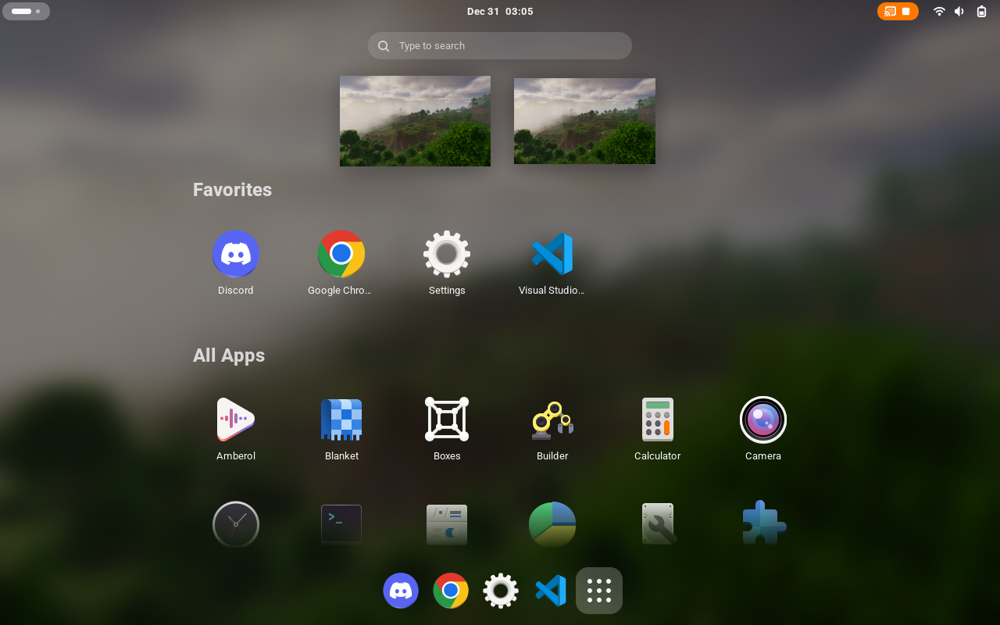

# Vertical App Grid
A GNOME Shell extension that turns the default horizontal app grid into a
vertical one. App icon size and spacing can be customized in the extension
preferences. App folders are shown in their own section above the other apps,
and apps can be moved into folders by drag and drop. A small badge below the
app name can tell how each app was installed (System, Flatpak, Snap, AppImage
or Web), and apps that share a name with another app (for example the same
program installed both as a system package and as a Flatpak) are highlighted.
Reordering apps by drag and drop is currently not supported.

